<a href="https://noras-salman.github.io/noras-salman/"><picture><source media="(prefers-color-scheme: dark)" srcset="assets/readme/banner-dark.svg"><source media="(prefers-color-scheme: light)" srcset="assets/readme/banner-light.svg"></picture></a>

**[Website](https://noras-salman.github.io/noras-salman/)** · **[LinkedIn](https://www.linkedin.com/in/norassalman/)**

I design high-availability systems and lead the teams that build them. I've been in the industry since 2011, working in fintech, SaaS, consulting and construction tech with teams in Sweden, the US, the UAE and Panama.

### What I work on

- **Applied AI:** LLM-powered product features, prompt engineering and machine learning, run with the same reliability standards as any other critical system.
- **Distributed systems:** fault-tolerant, event-driven microservices built for heavy transaction volume.
- **Security:** security is part of the architecture from the start, based on my studies in security and in CTF competitions.
- **Leadership:** hiring, mentoring, project planning and modernizing large codebases.

### Stack

<picture><source media="(prefers-color-scheme: dark)" srcset="assets/readme/stack-dark.svg"><source media="(prefers-color-scheme: light)" srcset="assets/readme/stack-light.svg"></picture>

### Selected work

<a href="https://noras-salman.github.io/noras-salman/"><picture><source media="(prefers-color-scheme: dark)" srcset="assets/readme/card-site-dark.svg"><source media="(prefers-color-scheme: light)" srcset="assets/readme/card-site-light.svg"></picture></a>&nbsp;<a href="https://github.com/noras-salman/baton"><picture><source media="(prefers-color-scheme: dark)" srcset="assets/readme/card-baton-dark.svg"><source media="(prefers-color-scheme: light)" srcset="assets/readme/card-baton-light.svg"></picture></a>
<a href="https://odr.chalmers.se/handle/20.500.12380/251871"><picture><source media="(prefers-color-scheme: dark)" srcset="assets/readme/card-ids-dark.svg"><source media="(prefers-color-scheme: light)" srcset="assets/readme/card-ids-light.svg"></picture></a>&nbsp;<a href="https://www.uppsatser.se/uppsats/239a42bb35/"><picture><source media="(prefers-color-scheme: dark)" srcset="assets/readme/card-saas-dark.svg"><source media="(prefers-color-scheme: light)" srcset="assets/readme/card-saas-light.svg"></picture></a>

<b>Education</b>

 

- **M.Sc. Computer Systems and Networks**, Chalmers University of Technology (2015–2017). Distributed Systems and Security tracks; member of [ChalmersCTF](https://chalmersctf.se).
- **M.Sc. Industrial Economics and Management (MBA)**, Blekinge Institute of Technology (2021–2023).

<b>Publications</b>

 

- [*Design and Implementation of an Intrusion Detection System (IDS) for In-Vehicle Networks*](https://odr.chalmers.se/handle/20.500.12380/251871). M.Sc. thesis, Chalmers, in collaboration with Volvo Cars, 2017.
- [*Unleashing Profitability: The Labor–R&D Nexus in SaaS Tech Firms*](https://www.uppsatser.se/uppsats/239a42bb35/). MBA thesis, BTH, 2023.

